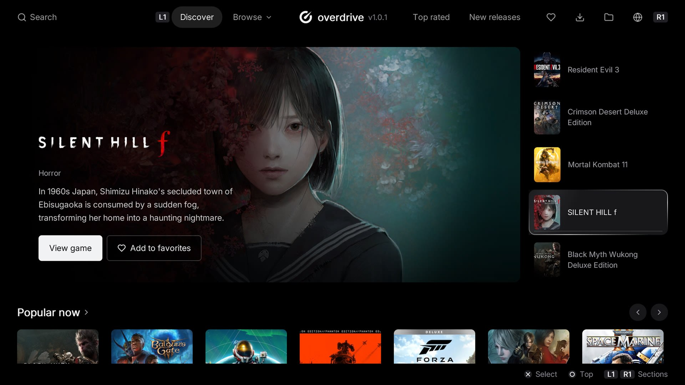
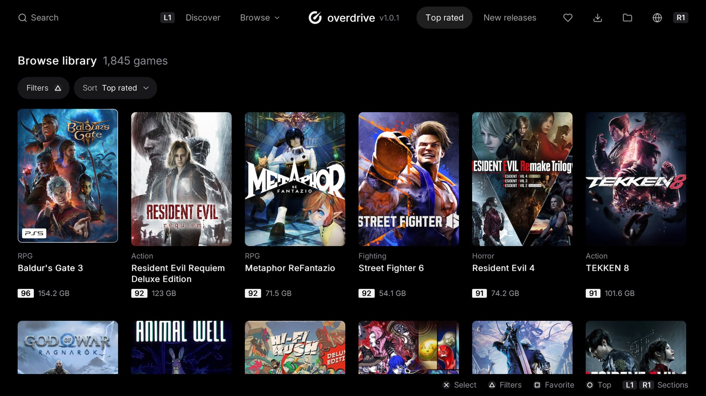
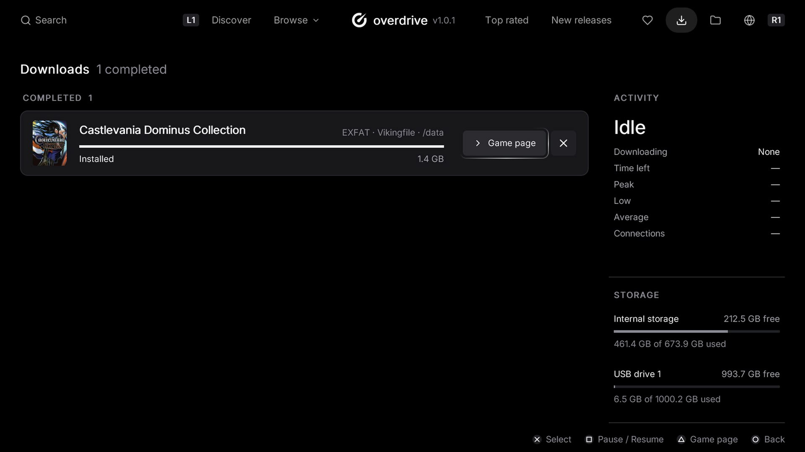
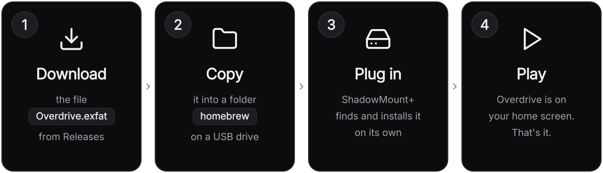

<p align="center">
  <picture>
    <source media="(prefers-color-scheme: dark)" srcset=".github/readme/logo-dark.svg">
    
  </picture>
</p>

<p align="center">
  <b>English</b> ·
  <a href="README.ru.md">Русский</a>
</p>

<p align="center">
  <b>Your PS5 game store.</b><br>
  Back from the dead, rebuilt from its own binary, with every line of source in the open.
</p>

<p align="center">
  <a href="https://github.com/B4ckd0orl/Padrino-Store/releases/latest"></a>
  <a href="https://github.com/B4ckd0orl/Padrino-Store/releases"></a>
  <a href="https://github.com/sponsors/MyLuxy"></a>
</p>

<p align="center">
  <a href="#install-in-four-steps">Install</a> ·
  <a href="#features">Features</a> ·
  <a href="#updates">Updates</a> ·
  <a href="#troubleshooting">Troubleshooting</a> ·
  <a href="#build-it-yourself">Build it yourself</a>
</p>

> [!NOTE]
> The original Overdrive project has been shut down so I decompiled the last released build,
> recovered the complete source and rebuilt it.

<p align="center">
  
</p>
<p align="center">
  
  
</p>

## Features

- **1,800+ games** to discover, with **Top rated**, **New releases** and a featured spotlight
- **Browse the whole library** with filters, sorting, scores and download sizes at a glance
- **Downloads straight to the console**, to internal storage or any USB drive, with live speed and storage stats
- **Favorites**, **search** with an on-screen keyboard, and a **Files** page to see and clean up what's on your drives
- **13 languages**: English, Deutsch, Español, Français, Português (Brasil), Русский, Bahasa Indonesia, 日本語, 简体中文, العربية, اردو, हिन्दी, বাংলা
- **Updates itself**: a new version installs from the console, no PC needed
- Made for the controller: <kbd>L1</kbd> <kbd>R1</kbd> to switch sections, <kbd>✕</kbd> to select, <kbd>○</kbd> to go back

## Install in four steps

<p align="center">
  
</p>

### Before you start

You need a **jailbroken PS5** running **[ShadowMount+](https://github.com/drakmor/ShadowMountPlus)**,
the payload that installs `.exfat` images by itself. If ShadowMount+ shows its notification
when the console starts, you are ready. You also need a **USB drive** and a **PC**.

<p align="center">
  <a href="https://github.com/B4ckd0orl/Padrino-Store/releases/latest/download/PadrinoStore.exfat"></a>
</p>

<table>
<tr>
<td width="64" align="center" valign="top"></td>
<td>

**Download `PadrinoStore.exfat`** with the button above, or from the
[latest release](https://github.com/B4ckd0orl/Padrino-Store/releases/latest). It is the only file you
need. Leave it as it is: don't unzip it and don't change the `.exfat` at the end of its name.

</td>
</tr>
<tr>
<td align="center" valign="top"></td>
<td>

**Copy it onto a USB drive, inside a folder called `homebrew`.** Plug the drive into your PC,
create a new folder named exactly `homebrew` (all lowercase) at the top level of the drive, and
copy `PadrinoStore.exfat` into it:

```text
USB drive
└── homebrew
    └── PadrinoStore.exfat
```

The drive must be formatted as **exFAT**, which is how most drives come and what the PS5 reads.

</td>
</tr>
<tr>
<td align="center" valign="top"></td>
<td>

**Plug the drive into the PS5.** ShadowMount+ checks for new files every few seconds: it finds
Padrino Store, mounts it and installs it, and a notification tells you when it's done. There is
nothing to click.

</td>
</tr>
<tr>
<td align="center" valign="top"></td>
<td>


**Open Padrino Store from the home screen.** Look for this icon. Enjoy!

</td>
</tr>
</table>

You can also use **any FTP client** to move the file onto the console's internal storage
instead, again inside a `homebrew` folder: `/data/homebrew/PadrinoStore.exfat`.

## Updates

You only install Padrino Store by hand once. When a new version comes out, the app tells you by
itself a few seconds after it opens:

1. A window shows the new version and what changed. Press **Install**.
2. Padrino Store downloads the update, checks it and puts it in place of the old one.
3. When it's done, the app **closes itself**. Open it again and you are on the new version.

The update needs about **600 MB free** on the drive that holds Padrino Store. `update.zip` in each
release is the package the app downloads for this; you never need it yourself.

## Support the project

Padrino Store is free and open source. If you enjoy it, sponsoring helps me keep it updated.

<p align="center">
  <a href="https://github.com/sponsors/MyLuxy"></a>
</p>

## Troubleshooting

<details>
<summary><b>Padrino Store doesn't appear on the home screen</b></summary>
<br>

- Make sure **ShadowMount+ is running**: it shows a notification when it starts.
- Check the folder: it must be called exactly `homebrew` and sit at the **top level** of the
  drive, not inside another folder.
- Check the file still ends in **`.exfat`**. Some PCs hide extensions: a file renamed to
  `PadrinoStore.exfat.zip` or unzipped into a folder won't be found.
- Give it a minute: ShadowMount+ waits until the file has finished copying before it installs it.

</details>

<details>
<summary><b>After an update, the app still shows the old version</b></summary>
<br>

The new version is installed but the console still has the old one loaded. **Restart the
console** and open Padrino Store again; the app tells you this itself if it happens twice in a row.

</details>

<details>
<summary><b>The update says there isn't enough space</b></summary>
<br>

The update is downloaded next to the installed app, so the drive holding Padrino Store needs about
600 MB free. Free some space on that drive and press **Retry**. Nothing has been changed yet
when this happens.

</details>

<details>
<summary><b>The update says it couldn't replace the app</b></summary>
<br>

Install it by hand: download `PadrinoStore.exfat` from the
[latest release](https://github.com/B4ckd0orl/Padrino-Store/releases/latest), close Padrino Store, and copy
the new file over the old one in the `homebrew` folder.

</details>

<details>
<summary><b>How do I remove Padrino Store?</b></summary>
<br>

Delete `PadrinoStore.exfat` from the `homebrew` folder first, then delete its icon from the home
screen. In the other order ShadowMount+ finds the file again and puts the icon back.

</details>

## Build it yourself

<details>
<summary><b>What's in this repository</b></summary>
<br>

| Path | What it is |
| --- | --- |
| `app/` | The application: JSX sources, state, assets, catalog data, and `app.json` (title id `PPSA99058`, version, capabilities) |
| `ps5-react/` | The framework it runs on, vendored from [half144/ps5-react](https://github.com/half144/ps5-react) |
| `packaging/make-exfat.sh` | Builds the exFAT image ShadowMount+ installs |
| `.github/workflows/build.yml` | The build |

</details>

<details>
<summary><b>How the source was recovered</b></summary>
<br>

Padrino Store is a React app running on [ps5-react](https://github.com/half144/ps5-react), and its
whole JavaScript bundle sits in plain text inside `eboot.bin`. A bundler merges every module into
one scope, so imports between modules turn into bare names; since each top-level name stays
unique, the module that declares a name can be worked out again. That split the bundle back into
its 137 original modules with their real `import`/`export` lines, checked against the original
bundle until every import edge matched.

What a bundler throws away could not come back: most comments, the JSX syntax (it reads as
`jsx(View, {…})` calls), and `const`/`let` (now `var`). None of that changes how the app behaves.

</details>

<details>
<summary><b>Building</b></summary>
<br>

Builds run on `ubuntu-24.04` with clang 18, only from **Run workflow**: a push builds nothing.
Each run puts `PadrinoStore.exfat` and `update.zip` in a draft release named after
`app/version.js`, which only maintainers can see.

The same build locally, on any Linux with the packages the workflow installs (`clang-18`,
`llvm-18`, `cmake`, `ninja-build`, `nodejs`, `npm`, `zlib1g-dev`, `build-essential`,
`pkg-config`, `unzip`, `curl`, `exfatprogs`, and Pillow from `ps5-react/requirements.txt`):

```sh
cd ps5-react
python3 tools/build_ps5.py --app-dir ../app --llvm /usr/bin
sudo ../packaging/make-exfat.sh dist/PPSA99058 ../PadrinoStore.exfat
```

The build downloads its pinned dependencies into `ps5-react/.deps` and writes the app folder, a
`.zip` and a `.receipt.json` into `ps5-react/dist`. It verifies the result itself
(`tools/verify.py`), so a green build means the payload structure and signatures check out.
`--llvm /usr/bin` points it at the system clang; upstream defaults to the Homebrew LLVM path
because macOS is its supported development environment.

The image is a plain exFAT volume whose root is the app folder, with 64 KiB clusters and the
label `OVERDRIVE`. To release a new version, raise the version in `app/version.js` and
`app/app.json`, run the workflow, test the draft's image on a console, then publish the draft:
that creates its tag, and installed apps offer exactly the tested files on their next start.

</details>

<details>
<summary><b>Fixes over upstream ps5-react</b></summary>
<br>

Two fixes in the vendored framework, both in the build tooling and both reported by a Linux build:

- `ps5-react/tools/common.py` read the `git apply --summary` line with a fixed space count, which
  glued the file mode onto the path (`100644 <path>`) and made every fresh dependency checkout
  fail on the first patch that creates a file. It now splits on whitespace.
- `ps5-react/tools/build_ps5.py` opened the pinned LLVM package's `data.tar.zst` with `tarfile`,
  which reads zstd only from Python 3.14 while the documented minimum is 3.12. It now falls back
  to the `zstd` command.

Nothing else in the framework is changed.

</details>

## Credits

- **[MyLuxy](https://github.com/MyLuxy)**, who decompiled Overdrive, recovered its source and rebuilt it.
- **[ps5-react](https://github.com/half144/ps5-react)**, the framework it runs on.
- **[ShadowMount+](https://github.com/drakmor/ShadowMountPlus)** by drakmor, which installs it.

`ps5-react/` is GPL-3.0-or-later and carries its own `LICENSE`, `LICENSE-ATTRIBUTION` and
`NOTICE`. Every dependency notice is copied into `notices/` inside the built app, and
`ps5-react/docs/DEPENDENCIES.md` lists them with their sources.

<sub>Padrino Store is an unofficial homebrew project and is not affiliated with or endorsed by Sony
Interactive Entertainment. PlayStation and PS5 are trademarks of Sony Interactive Entertainment.</sub>
